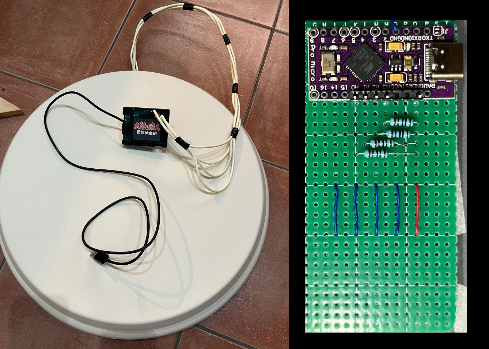
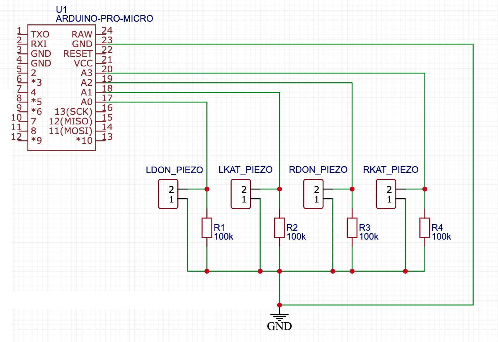

# Taiko Drum Controller - Arduino Pro Micro (ATmega32U4)

An open-source hardware project to build your own **Taiko no Tatsujin** arcade controller for PC gaming.

[查看繁体中文版](./README_zh-Hant.md) | [查看簡體中文版](./README_zh-Hans.md) | [查看日文版](./README_Japanese.md)

## About this Project

This project guides you in creating a custom Taiko no Tatsujin controller to enjoy the arcade experience at home.

> **Note:** This project is for personal and non-commercial use only.

---

## Materials Needed

To assemble your Taiko drum controller, you'll need:

1. **Arduino Micro/Leonardo** (with ATmega32U4 microcontroller)
2. **4 piezoelectric sensors**
3. **4 100kΩ resistors**
4. Essential electronic components (e.g., breadboards, jumper wires)
5. Wood planks and cutting tools (only if building the drum from scratch).  
   > If you have an aftermarket Taiko Force Lv5, you can use it directly.

---

## Steps to Build the Controller

1. **Prepare the Drum**  
   Construct the drum and securely attach the 4 piezoelectric sensors to it. See the diagram below for recommended sensor placement.

   

2. **Connect Components**  
   Wire the piezoelectric sensors and other components to the Arduino as shown in the schematic below.  
   > Note: Polarity doesn’t matter for the piezoelectric sensors. This setup is designed for Arduino Micro; if using another board, refer to its documentation.

   

3. **Flash the Firmware**  
   Upload the firmware to the Arduino board. You may need to adjust parameters such as `SAMPLE_CACHE_LENGTH`, `HIT_THRES`, `RESET_THRES`, and `sensitivity` as described below.

4. **Enjoy!**  
   Once configured, your controller is ready to use.

---

## Parameter Tuning

1. **Hit and Reset Thresholds**  
   Set `DEBUG 1` at the top of the sketch to disable keyboard output and stream signal values over the serial port. Open the Arduino IDE **Serial Plotter** (115200 baud) — the firmware plots all 4 channels plus the current `HIT` and `RESET` threshold lines. Roll across one of the drum’s 4 zones and observe the graph.  
   - **Hit threshold** (`HIT_THRES`): Should be lower than your hardest hit.
   - **Reset threshold** (`RESET_THRES`): Should be above the low point between hits (trough) and below the hit value. Raise it if fast drum rolls drop hits; lower it if single hits double-trigger.  

   Repeat this process for each drum area to find optimal thresholds, then set `DEBUG` back to `0`.

   

2. **Sampling Length**  
   Set `SAMPLE_CACHE_LENGTH` (in the sketch) to a power of 2 (e.g., 8, 16, 32). A value of **16** is optimal for Arduino, but if you’re using a faster microcontroller (sampling at 4000Hz or more), you can set it to **32** for a smoother signal.

3. **Sensor Sensitivity**  
   Sensor output can vary. Use the per-channel `*_SENS` parameters (in percent, `100` = 1.00×) to normalize discrepancies. For example, if the **right-don** zone outputs higher values, set `R_DON_SENS` to `50` (0.50×) to balance the response.

   

   > Proper sensor installation is critical. Ensure sensors are securely attached to the drum.

4. **Auto Adjust (self-tuning)**  
   With `AUTO_ADJUST 1` (the default) the firmware tunes itself, arcade-style:
   - **Noise-floor calibration** — for the first ~0.5 s after plugging in, each sensor's idle level is measured and subtracted from all readings, so electrical noise or a loose sensor can never cause phantom hits. **Keep the drum untouched while it calibrates.**
   - **Adaptive threshold** — after every hit, the effective hit threshold rides at `AUTO_THRES_RATIO`% (default 150%) of the hit's live signal and then decays back to `HIT_THRES` (`AUTO_THRES_DECAY`, ~34 ms half-life). Residual ringing from a hard hit can never re-trigger, while soft hits and fast rolls still register.
   - **Auto balance** (`AUTO_BALANCE 1`) — the firmware tracks each zone's average hit strength and slowly adjusts per-channel gain so all four zones respond equally (bounded by `AUTO_BALANCE_MIN`/`MAX`). Manual `*_SENS` values still apply on top.

5. **Advanced Options**  
   - `KEY_HOLD_MS` — how long each key press is held (default 25 ms, ≥ one game frame so hits are never missed).
   - `DOUBLE_HITS` — when `1`, hitting both dons (or both kats) at once registers both keys, for two-handed big notes. Set to `0` if sensor crosstalk on your drum causes phantom double hits.
   - `HIT_SCAN_US` — after the first sensor crosses the threshold, the firmware keeps sampling for this window and outputs the **loudest** sensor, which rejects crosstalk between zones.

6. **Companion App — input test & live settings**  
   Open [`tools/InputTest.html`](./tools/InputTest.html) in Chrome or Edge. Everything is in one window, switchable between 中文 / 日本語 / English:
   - **Input test**: click the page and hit the drum — live roll counter, per-zone hit history, hits-per-second graph, and per-zone totals on a drum diagram.
   - **Controller settings**: click **Connect over USB**, edit any setting — hit/reset thresholds, key hold, scan window, big notes, adaptive threshold, auto balance, per-zone sensitivities, and key bindings — and press **Update settings**. Changes apply instantly and are saved to the controller's EEPROM: **no recompiling or re-flashing needed**.
   - **Signal monitor**: streams live sensor power and the adaptive threshold from the controller, so you can tune thresholds without the Arduino IDE (this replaces the `DEBUG` workflow above for most users).

7. **Launch the Game**  
   With tuning complete, start the game and enjoy your custom Taiko controller!

--- 
