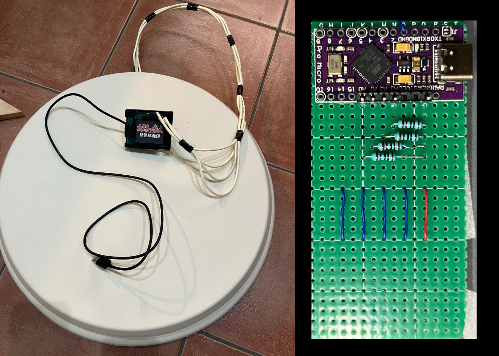
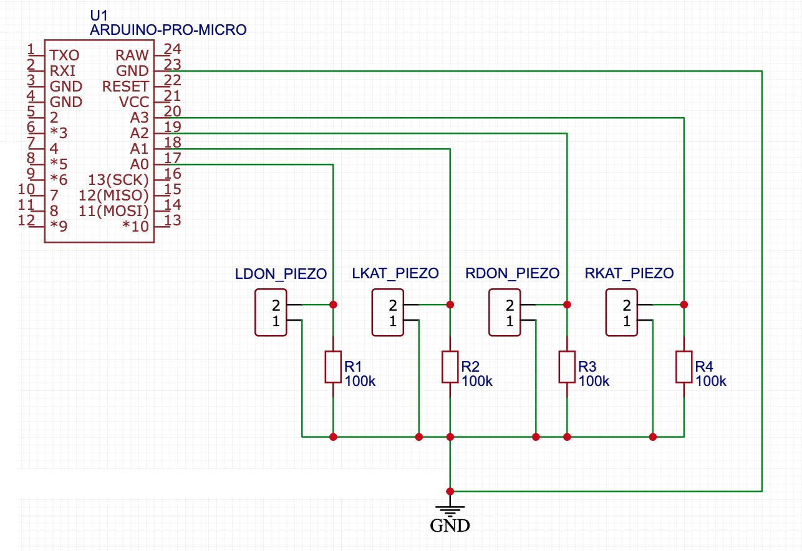

# 太鼓ドラムコントローラー - Arduino Pro Micro (ATmega32U4)

自分の**太鼓の達人**アーケードコントローラーをPC用に作成するためのオープンソースハードウェアプロジェクトです。

[簡体字版はこちら](./README_zh-Hans.md) | [繁体字版はこちら](./README_zh-Hant.md) | [View English Version](./README.md)

## プロジェクトについて

このプロジェクトは、あなたが自宅でハードウェアの太鼓を開発する手助けをすることを目的としています。

> **注意：** このプログラムは個人及び非商業的な利用のみを目的としています。

---

## 必要なもの

1. **Arduino Micro/Leonardo**（ATmega32U4搭載）
2. **4つの圧電センサー**
3. **4つの100kΩ抵抗**
4. 必要な電子部品（ブレッドボード、ジャンパーワイヤーなど）
5. 木材と切断工具（太鼓を一から作成する場合のみ必要）  
   > もしアフターマーケットのTaiko Force Lv5があれば、それを直接使用できます。

---

## コントローラーの作り方

1. **ドラムを作成する**  
   ドラムを作り、4つの圧電センサーをしっかりと接着します。センサーの推奨位置は以下の画像を参考にしてください。

   

2. **コンポーネントを接続する**  
   圧電センサーや他のコンポーネントを次のようにコントローラーに接続します。  
   > 注意：圧電センサーの極性は関係ありません。このスキームはArduino Microボード用です。異なるボードを使用する場合は、そのドキュメントを参照してください。

   

3. **ファームウェアをフラッシュする**  
   ボードにファームウェアをフラッシュします。  
   `SAMPLE_CACHE_LENGTH`、`HIT_THRES`、`RESET_THRES`、および`sensitivity`などのパラメータを微調整する必要があるかもしれません。詳細は次のセクションを参照してください。

4. **楽しんでください！**  
   セットアップが完了したら、ゲームをお楽しみください。

---

## パラメータの調整

1. **ヒットおよびリセット閾値**  
   スケッチの先頭で`DEBUG 1`を設定すると、キーボード出力が無効になり、シリアルポートへ信号値が送信されます。Arduino IDEの**シリアルプロッタ**（115200ボー）を開くと、4チャンネルの信号と現在の`HIT`・`RESET`閾値ラインが表示されます。ドラムの4つのエリアのいずれかを叩いて、出力グラフを確認してください。  
   - **ヒット閾値**（`HIT_THRES`）：最も強いヒットよりも低く設定します。
   - **リセット閾値**（`RESET_THRES`）：ヒット間の谷よりも大きく、ヒット値よりも低い必要があります。高速連打で取りこぼしがある場合は上げ、1回のヒットが2回反応する場合は下げてください。  

   残りの3つのエリアについてもこのプロセスを繰り返し、最適な値を見つけたら`DEBUG`を`0`に戻してください。

   

2. **サンプリング長**  
   スケッチ内の`SAMPLE_CACHE_LENGTH`を2の冪（例：8、16、32）に設定します。Arduinoに対しては**16**が最適な値ですが、入力を4000Hz以上でサンプリングする強力なマイクロコントローラを使用している場合は、**32**に変更して、より滑らかな（つまり、ノイズの少ない）曲線を得ることができます。

3. **感度**  
   すべての圧電センサーが同じではなく、取り付けエラーのために4つのセンサーからの信号が大きく異なることがあります。各チャンネルの`*_SENS`パラメータ（パーセント指定、`100` = 1.00倍）で差異を正規化できます。たとえば、右ドンエリアが他の3つよりもはるかに高い値を生成する場合、`R_DON_SENS`を`50`（0.50倍）に設定して問題を解決できます。

   

   > センサーの取り付けは非常に重要です。センサーがしっかりと木材に取り付けられ、正しい位置にあることを確認してください。

4. **オート調整（自己チューニング）**  
   `AUTO_ADJUST 1`（デフォルトで有効）にすると、ファームウェアがアーケードのように自己調整します：
   - **ノイズフロア校正** — 接続後約0.5秒間、各センサーの無音レベルを測定してすべての読み値から差し引きます。電気ノイズや緩んだセンサーが誤反応を起こすことはありません。**校正中はドラムに触れないでください。**
   - **適応閾値** — ヒットのたびに、有効なヒット閾値がそのヒットのリアルタイム信号の `AUTO_THRES_RATIO`%（デフォルト150%）に追従し、その後 `HIT_THRES` まで減衰します（`AUTO_THRES_DECAY`、半減期約34ミリ秒）。強打の残響が再トリガーすることはなく、弱打や高速連打は正常に判定されます。
   - **オートバランス**（`AUTO_BALANCE 1`）— 各エリアの平均ヒット強度を追跡し、4つのエリアが均等に反応するよう各チャンネルのゲインをゆっくり調整します（`AUTO_BALANCE_MIN`/`MAX` の範囲内）。手動の `*_SENS` 値はその上に適用されます。

5. **高度なオプション**  
   - `KEY_HOLD_MS` — キーを押し続ける時間（デフォルト25ミリ秒、ゲームの1フレーム以上にすることで取りこぼしを防ぎます）。
   - `DOUBLE_HITS` — `1`にすると、両方のドン（または両方のカッ）を同時に叩いたときに両方のキーが出力され、両手での大音符に対応します。センサー間のクロストークで誤検出が起きる場合は`0`にしてください。
   - `HIT_SCAN_US` — 最初のセンサーが閾値を超えた後、この時間ウィンドウの間サンプリングを継続し、**最も強い**センサーを出力します。これによりエリア間のクロストークによる誤判定を防ぎます。

6. **コンパニオンアプリ — 入力テスト＆ライブ設定**  
   Chrome または Edge で [`tools/InputTest.html`](./tools/InputTest.html) を開いてください。すべての機能が1つのウィンドウにまとまっており、中文 / 日本語 / English を切り替えられます：
   - **入力テスト**：ページをクリックしてドラムを叩くと、連打カウンター、エリアごとのヒット履歴、秒間ヒット数グラフ、ドラム図上のエリア別合計をリアルタイム表示。
   - **コントローラー設定**：**USBケーブルで接続**をクリックすると、すべての設定 — ヒット/リセット閾値、キー保持時間、判定窓、大音符、適応閾値、オートバランス、エリア別感度、キー割り当て — を編集でき、**設定更新**で反映されます。変更は即座に適用され、コントローラーのEEPROMに保存されます：**再コンパイルや再書き込みは不要です**。
   - **信号モニター**：各センサーの信号と適応閾値をコントローラーからリアルタイムで表示。Arduino IDEなしで閾値を調整できます（多くの場合、上記の `DEBUG` 手順の代わりになります）。

7. **ゲームを起動して楽しむ**  
   調整が完了したら、ゲームを起動し、自分だけのカスタム太鼓コントローラーを楽しんでください！

---
