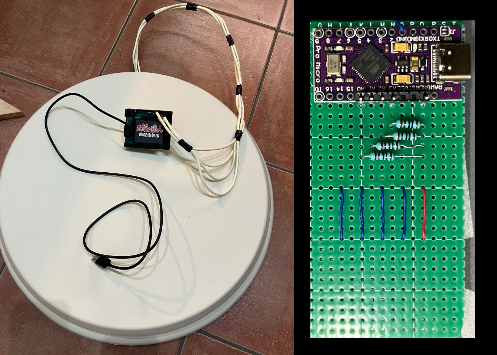
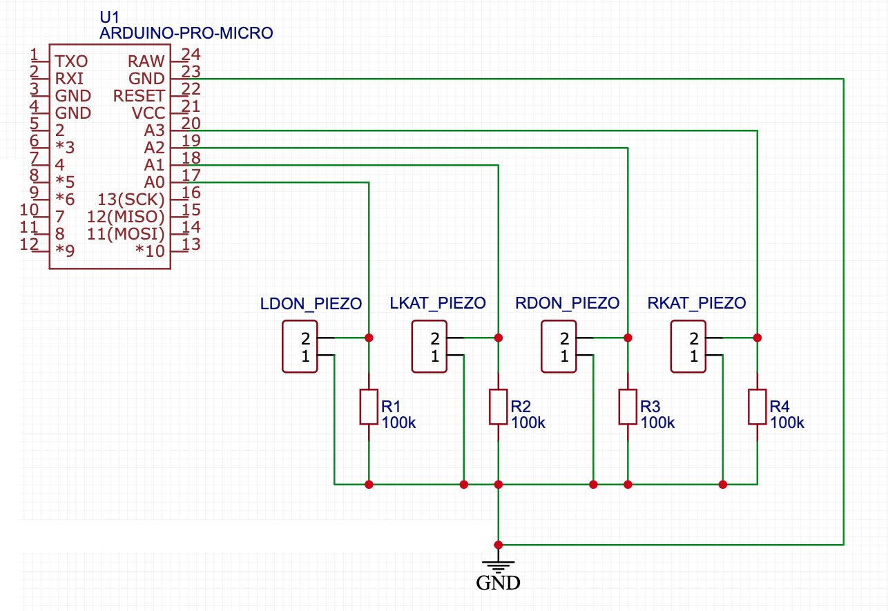

# 太鼓鼓控制器 - Arduino Pro Micro (ATmega32U4)

一个开源硬件项目，帮助你制作自己的**太鼓达人**PC控制器。

[查看繁体中文版](./README_zh-Hant.md) | [查看日文版](./README_Japanese.md) | [View English Version](./README.md)

## 关于本项目

本项目旨在帮助你创建一个自定义的太鼓达人控制器，让你在家中享受街机体验。

> **注意：** 本项目仅供个人和非商业用途。

---

## 所需材料

制作太鼓鼓控制器所需的材料：

1. **Arduino Micro/Leonardo**（带ATmega32U4微控制器）
2. **4个压电传感器**
3. **4个100kΩ电阻**
4. 基本电子元件（如面包板、跳线）
5. 木板和切割工具（仅在你从头开始制作鼓时需要）  
   > 如果你有售后市场的Taiko Force Lv5，也可以直接使用它。

---

## 制作步骤

1. **准备鼓**  
   制作鼓并将4个压电传感器牢固地粘在上面。参考下图查看传感器的推荐位置。

   

2. **连接组件**  
   按下图所示将压电传感器和其他组件连接到Arduino。  
   > 注意：压电传感器的极性无关紧要。本设计适用于Arduino Micro，如果使用其他板子，请参考其文档。

   

3. **烧录固件**  
   将固件上传到Arduino板上。可能需要调整一些参数，例如 `SAMPLE_CACHE_LENGTH`、`HIT_THRES`、`RESET_THRES` 和 `sensitivity`，详情见下文。

4. **开始游戏！**  
   设置完成后，控制器就可以使用了。

---

## 参数调整

1. **命中和重置阈值**  
   在代码开头设置 `DEBUG 1` 以禁用键盘输出，并通过串口输出信号值。打开 Arduino IDE 的**串口绘图仪**（115200 波特率），固件会绘制4个通道以及当前的 `HIT` 和 `RESET` 阈值线。滚动鼓的4个区域之一，观察输出图形。  
   - **命中阈值**（`HIT_THRES`）：应低于你最重的敲击。
   - **重置阈值**（`RESET_THRES`）：应高于滚动敲击之间的低点（波谷）并低于命中值。如果快速连打丢失敲击，请调高；如果单次敲击触发两次，请调低。  

   对每个鼓区重复此过程以找到最佳阈值，然后将 `DEBUG` 改回 `0`。

   

2. **采样长度**  
   在代码中将 `SAMPLE_CACHE_LENGTH` 设置为2的幂（如8、16、32）。对于Arduino，**16** 是最佳值；如果你使用更快的微控制器（采样速度达到4000Hz或更高），可以设置为 **32**，以获得更平滑的信号。

3. **传感器灵敏度**  
   传感器输出可能会有所不同。使用各通道的 `*_SENS` 参数（百分比，`100` = 1.00倍）来规范差异。例如，如果 **右-don** 区域输出较高的值，可以将 `R_DON_SENS` 设置为 `50`（0.50倍）来平衡响应。

   

   > 传感器的安装非常重要。确保传感器牢固地固定在木板上。

4. **自动调整（自我校准）**  
   `AUTO_ADJUST 1`（默认开启）时，固件会像街机一样自我调整：
   - **底噪校准** — 插入后约0.5秒内测量每个传感器的静态信号并从所有读数中扣除，电气噪声或松动的传感器不会再造成误触发。**校准期间请勿触碰鼓面。**
   - **自适应阈值** — 每次敲击后，有效命中阈值会跟随该次敲击实时信号的 `AUTO_THRES_RATIO`%（默认150%），然后衰减回 `HIT_THRES`（`AUTO_THRES_DECAY`，半衰期约34毫秒）。重击的余震不会再次触发，而轻击和快速连打仍能正常判定。
   - **自动平衡**（`AUTO_BALANCE 1`）— 固件会跟踪每个区域的平均敲击强度，缓慢调整各通道增益，使4个区域反应一致（受 `AUTO_BALANCE_MIN`/`MAX` 限制）。手动 `*_SENS` 值仍会叠加生效。

5. **高级选项**  
   - `KEY_HOLD_MS` — 每次按键保持的时间（默认25毫秒，≥ 一个游戏帧，确保不会漏判）。
   - `DOUBLE_HITS` — 设为 `1` 时，同时敲击两个 don（或两个 kat）会同时输出两个按键，用于双手大音符。如果你的鼓串音导致误触发双击，请设为 `0`。
   - `HIT_SCAN_US` — 第一个传感器超过阈值后，固件会在此时间窗口内继续采样，并输出**最响**的传感器，以消除区域间的串音误判。

6. **配套软件 — 输入测试与实时设置**  
   用 Chrome 或 Edge 打开 [`tools/InputTest.html`](./tools/InputTest.html)。所有功能集中在同一个窗口，可切换 中文 / 日本語 / English：
   - **输入测试**：点击页面后敲鼓 — 实时连打计数、各区域敲击记录、每秒打数图表、鼓面各区域总计。
   - **控制器设置**：点击**通过USB线连接**，即可修改所有设置 — 命中/重置阈值、按键保持时间、判定窗口、大音符、自适应阈值、自动平衡、各区域灵敏度与按键绑定 — 然后按**更新设置**。更改立即生效并保存到控制器的EEPROM：**无需重新编译或重新烧录**。
   - **信号监视**：从控制器实时串流各传感器信号与自适应阈值，不用 Arduino IDE 也能调整阈值（大多数情况下可取代上述 `DEBUG` 流程）。

7. **启动游戏**  
   调整完成后，启动游戏，享受你的自定义太鼓控制器！

---
