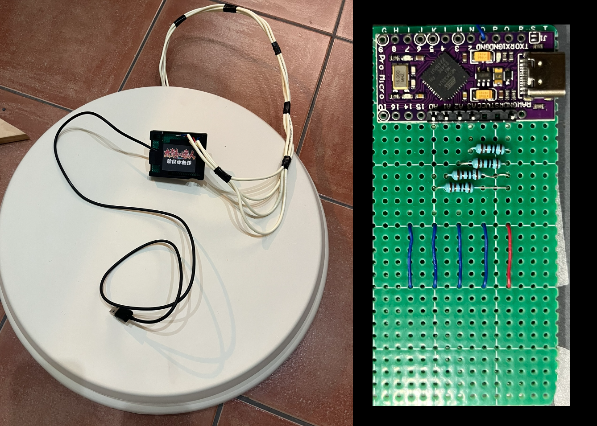
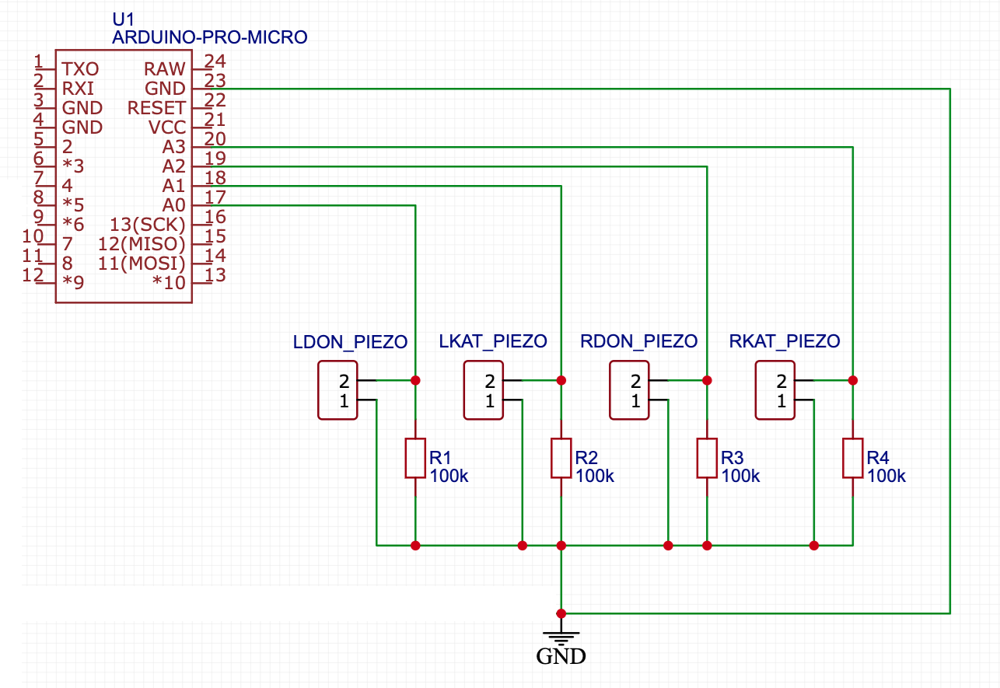

# 太鼓鼓控制器 - Arduino Pro Micro (ATmega32U4)

一個開源硬件專案，幫助你製作自己的**太鼓達人**PC控制器。

[查看簡體中文版](./README_zh-Hans.md) | [查看日文版](./README_Japanese.md) | [View English Version](./README.md)

## 關於本專案

本專案旨在幫助你創建一個自定義的太鼓達人控制器，讓你在家中享受街機體驗。

> **注意：** 本專案僅供個人和非商業用途。

---

## 所需材料

製作太鼓鼓控制器所需的材料：

1. **Arduino Micro/Leonardo**（帶ATmega32U4微控制器）
2. **4個壓電傳感器**
3. **4個100kΩ電阻**
4. 基本電子元件（如麵包板、跳線）
5. 木板和切割工具（僅在你從頭開始製作鼓時需要）  
   > 如果你有售後市場的Taiko Force Lv5，也可以直接使用它。

---

## 製作步驟

1. **準備鼓**  
   製作鼓並將4個壓電傳感器牢固地黏在上面。參考下圖查看傳感器的推薦位置。

   

2. **連接組件**  
   按下圖所示將壓電傳感器和其他組件連接到Arduino。  
   > 注意：壓電傳感器的極性無關緊要。本設計適用於Arduino Micro，如果使用其他板子，請參考其文件。

   

3. **燒錄韌體**  
   將韌體上傳到Arduino板上。可能需要調整一些參數，例如 `SAMPLE_CACHE_LENGTH`、`HIT_THRES`、`RESET_THRES` 和 `sensitivity`，詳情見下文。

4. **開始遊戲！**  
   設置完成後，控制器就可以使用了。

---

## 參數調整

1. **命中和重置閾值**  
   在程式碼開頭設置 `DEBUG 1` 以禁用鍵盤輸出，並透過串口輸出信號值。打開 Arduino IDE 的**串口繪圖儀**（115200 波特率），韌體會繪製4個通道以及當前的 `HIT` 和 `RESET` 閾值線。滾動鼓的4個區域之一，觀察輸出圖形。  
   - **命中閾值**（`HIT_THRES`）：應低於你最重的敲擊。
   - **重置閾值**（`RESET_THRES`）：應高於滾動敲擊之間的低點（波谷）並低於命中值。如果快速連打丟失敲擊，請調高；如果單次敲擊觸發兩次，請調低。  

   對每個鼓區重複此過程以找到最佳閾值，然後將 `DEBUG` 改回 `0`。

   

2. **採樣長度**  
   在程式碼中將 `SAMPLE_CACHE_LENGTH` 設置為2的冪（如8、16、32）。對於Arduino，**16** 是最佳值；如果你使用更快的微控制器（採樣速度達到4000Hz或更高），可以設置為 **32**，以獲得更平滑的信號。

3. **傳感器靈敏度**  
   傳感器輸出可能會有所不同。使用各通道的 `*_SENS` 參數（百分比，`100` = 1.00倍）來規範差異。例如，如果 **右-don** 區域輸出較高的值，可以將 `R_DON_SENS` 設置為 `50`（0.50倍）來平衡響應。

   

   > 傳感器的安裝非常關鍵。確保傳感器牢固地附著在鼓上。

4. **自動調整（自我校準）**  
   `AUTO_ADJUST 1`（預設開啟）時，韌體會像街機一樣自我調整：
   - **底噪校準** — 插入後約0.5秒內測量每個傳感器的靜態訊號並從所有讀數中扣除，電氣噪聲或鬆動的傳感器不會再造成誤觸發。**校準期間請勿觸碰鼓面。**
   - **自適應閾值** — 每次敲擊後，有效命中閾值會跟隨該次敲擊即時訊號的 `AUTO_THRES_RATIO`%（預設150%），然後衰減回 `HIT_THRES`（`AUTO_THRES_DECAY`，半衰期約34毫秒）。重擊的餘震不會再次觸發，而輕擊和快速連打仍能正常判定。
   - **自動平衡**（`AUTO_BALANCE 1`）— 韌體會追蹤每個區域的平均敲擊強度，緩慢調整各通道增益，使4個區域反應一致（受 `AUTO_BALANCE_MIN`/`MAX` 限制）。手動 `*_SENS` 值仍會疊加生效。

5. **進階選項**  
   - `KEY_HOLD_MS` — 每次按鍵保持的時間（預設25毫秒，≥ 一個遊戲幀，確保不會漏判）。
   - `DOUBLE_HITS` — 設為 `1` 時，同時敲擊兩個 don（或兩個 kat）會同時輸出兩個按鍵，用於雙手大音符。如果你的鼓串音導致誤觸發雙擊，請設為 `0`。
   - `HIT_SCAN_US` — 第一個傳感器超過閾值後，韌體會在此時間窗口內繼續採樣，並輸出**最響**的傳感器，以消除區域間的串音誤判。

6. **配套軟體 — 輸入測試與即時設定**  
   用 Chrome 或 Edge 打開 [`tools/InputTest.html`](./tools/InputTest.html)。所有功能集中在同一個視窗，可切換 中文 / 日本語 / English：
   - **輸入測試**：點擊頁面後敲鼓 — 即時連打計數、各區域敲擊記錄、每秒打數圖表、鼓面各區域總計。
   - **控制器設定**：點擊**USBケーブルで接続（透過USB線連接）**，即可修改所有設定 — 命中/重置閾值、按鍵保持時間、判定窗口、大音符、自適應閾值、自動平衡、各區域靈敏度與按鍵綁定 — 然後按**設定更新**。變更立即生效並儲存到控制器的EEPROM：**無需重新編譯或重新燒錄**。
   - **信號監視**：從控制器即時串流各傳感器訊號與自適應閾值，不用 Arduino IDE 也能調整閾值（大多數情況下可取代上述 `DEBUG` 流程）。

7. **啟動遊戲**  
   調整完成後，啟動遊戲並享受你的自定義太鼓控制器！

---
